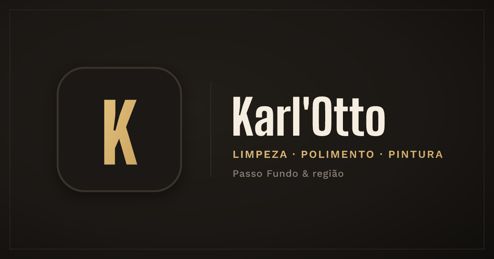

<h1 align="center"> Karl'Otto ✨</h1>

Site institucional da Karl'Otto, empresa de limpeza, polimento e pintura em Passo Fundo

  <a href="#-tecnologias">Tecnologias</a>&nbsp;&nbsp;&nbsp;|&nbsp;&nbsp;&nbsp;
  <a href="#-projeto">Projeto</a>

  
 

## 🚀 Tecnologias

Esse projeto foi desenvolvido com as seguintes tecnologias:

- HTML e CSS
- JavaScript
- GSAP
- Three.js
- Git e Github

## 💻 Projeto

- Site institucional da Karl'Otto, empresa de Passo Fundo especializada em polimento de porcelanato, tratamento de pedras naturais, limpeza de placas solares, limpeza pós-obra, lavagem de fachada e pintura. A página apresenta os serviços, o passo a passo do atendimento e os diferenciais técnicos, com todos os botões de contato levando ao orçamento pelo WhatsApp.

- O site é estático, feito com HTML, CSS e JavaScript puro, com animações em GSAP e um objeto 3D no hero renderizado com Three.js e adaptado para mobile. Tem meta tags Open Graph e Twitter Card com imagem de preview para compartilhamento em redes sociais.

<h2 align="center">📌 Desenvolvedores</h2>

<table align="center">
  <tr>
    <td align="center">
      <a href="https://github.com/rebellatoGui" title="GitHub">
         
        
          <b>Guilherme Rebellato</b>
        
      </a>
    </td>
  </tr>
</table>

 

---

Feito com ♥ por rebellatoGui

